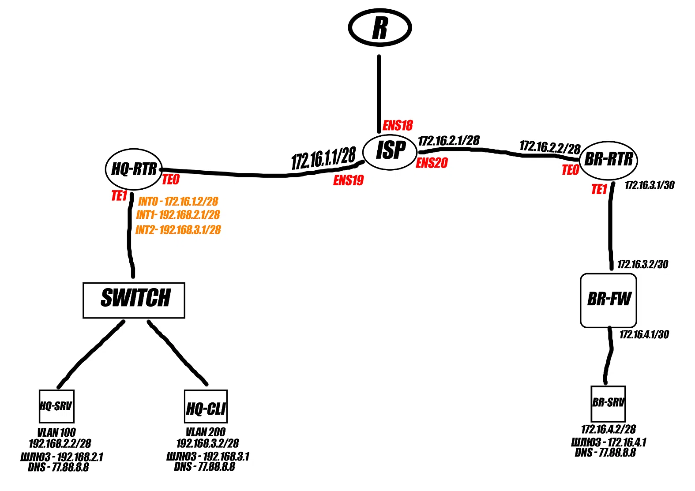

# 🖧 Модуль 1 — настройка сетевой инфраструктуры

**Экзаменационное решение · конспект команд · схема сети**

---

## 📌 О проекте

Репозиторий содержит структурированное решение первого модуля по настройке сетевой инфраструктуры. Материал собран по исходному файлу с командами и схеме экзаменационной сети.

> **Важно:** это оформленный конспект исходного решения, а не подтверждение успешной проверки в конкретной версии ОС/сетевой платформы. Перед использованием сверяйте синтаксис команд с оборудованием и заданием на экзамене.

## 🗺️ Состав сети

| Узел | Роль по схеме |
|---|---|
| `ISP` | Маршрутизация между площадками и выход во внешнюю сеть |
| `HQ-RTR` | Маршрутизатор главного офиса |
| `BR-RTR` | Маршрутизатор филиала |
| `BR-FW` | Межсетевой экран филиала |
| `HQ-SRV` | Сервер главного офиса |
| `HQ-CLI` | Клиент главного офиса |
| `BR-SRV` | Сервер филиала |
| `SWITCH` | Коммутатор с VLAN-сегментами |

## 🧭 Адресация по схеме

| Сегмент / интерфейс | Адрес |
|---|---|
| ISP `ens19` | `172.16.1.1/28` |
| ISP `ens20` | `172.16.2.1/28` |
| HQ-RTR → ISP | `172.16.1.2` (в конфигурации маршрутизатора) |
| BR-RTR → ISP | `172.16.2.2` (в конфигурации маршрутизатора) |
| HQ-SRV | `192.168.2.2/28` на схеме |
| HQ-RTR `INT1` / шлюз серверной сети в конфигурации | `192.168.2.1` |
| HQ-RTR `INT2` / шлюз клиентской сети в конфигурации | `192.168.3.1` |
| HQ-CLI | `192.168.3.2/28` на схеме |
| HQ-RTR ↔ BR-RTR, GRE | `10.10.10.1/30` ↔ `10.10.10.2/30` |
| BR-RTR → BR-FW | `172.16.3.1/30` |
| BR-FW → BR-RTR | `172.16.3.2/30` |
| BR-FW → BR-SRV | `172.16.4.1/30` |
| BR-SRV | `172.16.4.2/30` |
| VLAN 999 (управление коммутатором) | `192.168.99.0/30` в конфигурации HQ-RTR |

**DNS, указанный в исходных материалах:** `77.88.8.8` на HQ-SRV и HQ-CLI; BR-SRV использует `172.16.4.1` по схеме.

## ⚙️ Что настраивается

- сетевые интерфейсы и статические маршруты на `ISP`;
- интерфейсы и VLAN 100 / 200 / 999 на `HQ-RTR`;
- GRE-туннель между `HQ-RTR` и `BR-RTR`;
- динамическая маршрутизация OSPF через GRE;
- MD5-аутентификация OSPF на туннеле;
- NAT для сетей главного офиса и филиала;
- DHCP-пул для VLAN 200;
- сохранение конфигурации маршрутизаторов.

## 📂 Файлы репозитория

- [`docs/topology-and-addressing.md`](docs/topology-and-addressing.md) — схема, адресация и замечания по проверке.
- [`configs/isp-linux.md`](configs/isp-linux.md) — команды настройки ISP и HQ-SRV и BR-SRV и HQ-CLI и FW-DT.
- [`configs/hq-rtr.txt`](configs/hq-rtr.md) — настройка HQ-RTR 
- [`configs/br-rtr.txt`](configs/br-rtr.txt) — настройка BR-RTR 
- [`assets/topology.png`](assets/topology.png) — схема экзаменационной сети.

 ## НУ ТЫ ЗНАЕШЬ ЧТО ДЕЛАТЬ)
 https://www.donationalerts.com/r/daimonfantic2007

## ⚠️ Дисклеймер

**Вся представленная здесь настройка — исключительно моя работа и моя ответственность.**

Вы можете доверять этому решению или не доверять — это исключительно ваше дело. Я не претендую на абсолютную правильность всех настроек, поэтому **обязательно перепроверяйте IP-адреса, маски подсетей, шлюзы и другие параметры**. Я тоже могу ошибаться, и некоторые значения могли быть указаны неправильно.

Команды я лично проверял, и, насколько мне известно, всё работало. Однако это не гарантирует, что решение без изменений заработает в другой конфигурации или на другой версии системы.

**Используйте материалы на свой страх и риск, проверяйте настройки и не забывайте думать своей головой.** Это мой вариант решения, а не официальная документация или гарантия идеального результата.

